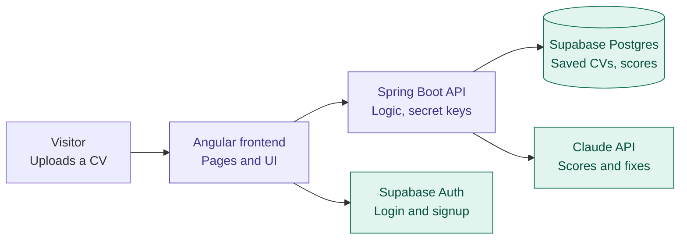

# ApplyCraft: AI Application Assistant

> 🚧 **In active development.** Not production-ready yet.

ApplyCraft helps job seekers find the right job, tailor their CV to it, and get past ATS filters. Upload a CV to get an AI-powered ATS score, see missing keywords and fix issues with one click.

## Features
- ATS score with category breakdown
- Job match: matched and missing keywords
- AI fixes and tailoring to a job description
- ATS-friendly PDF export
- Accounts, saved CVs and score history

**Planned:** job search, cover letter generator, AI interview practice, paid plans.

## Tech stack
- **Frontend:** Angular, TypeScript
- **Backend:** Java, Spring Boot
- **Database & auth:** Supabase (PostgreSQL, EU region)
- **AI:** Claude API (Anthropic)

## Architecture



All secret keys stay in the backend. The frontend only uses the public Supabase key.

## Run locally

```bash
# Backend
cd backend
cp .env.example .env   # fill in your values
./mvnw spring-boot:run

# Frontend
cd frontend
npm install
npm start
```

Open http://localhost:4200

## Design tokens

All colours live as CSS variables in [`frontend/src/styles.scss`](frontend/src/styles.scss). **No hardcoded colours:** components use these tokens only, never hex values. The one exception is the Google logo in `google-button.ts`, whose colours are set by Google's brand guidelines.

**Primary**

| Token | Value |
| --- | --- |
| `--primary-50` | `#F1F0FE` |
| `--primary-100` | `#E2DFFD` |
| `--primary-200` | `#C7C1FA` |
| `--primary-400` | `#8577EE` |
| `--primary-600` | `#5B4FD6` |
| `--primary-700` | `#4A3FB8` |
| `--primary-900` | `#282366` |
| `--primary-gradient` | `linear-gradient(135deg, #6D5DF5, #4338CA)` |

**Themes.** The light theme is the default (marketing pages). Add `.theme-dark` to a layout's root element for the dark theme (app shell, log-in / sign-up, dashboard, onboarding, the dark product mock-ups).

| Token | Light | Dark |
| --- | --- | --- |
| `--bg` | `#FAFAF8` | `#0F1629` |
| `--surface` | `#FFFFFF` | `#161F36` |
| `--border` | `#E7E6E1` | `#1F2A44` |
| `--text` | `#1C1B29` | `#F5F6FA` |
| `--text-secondary` | `#5F5E6E` | `#A9B0C3` |
| `--text-muted` | `#7A7987` | `#7C849A` |

**Status and scores**

| Token | Value | | Token | Value |
| --- | --- | --- | --- | --- |
| `--danger` | `#E5484D` | | `--danger-bg` / `--danger-text` | `#FDECEC` / `#B4232A` |
| `--warning` | `#E8A13A` | | `--warning-bg` / `--warning-text` | `#FDF3E1` / `#A15C07` |
| `--success` | `#12A594` | | `--success-bg` / `--success-text` | `#E6F6F3` / `#0D7A6E` |

**Semantic aliases** (built from the tokens above, and switched by `.theme-dark`):
- **Buttons:** `--button-bg`, `--button-bg-hover`, `--button-text`. Light: `--primary-600` / `--primary-700` with white text. Dark: `--primary-400` with `--primary-900` text.
- **Links and active nav items:** `--accent`, `--accent-hover`, `--accent-soft`.
- **Pills and badges:** `--pill-bg` / `--pill-text` (`--primary-50` on `--primary-900` in light).
- **Surfaces, borders, focus, shadows:** `--surface-muted`, `--surface-raised`, `--border-strong`, `--focus-ring`, `--overlay`, `--shadow`, `--shadow-lg`.
- **Scores:** `--score-low`, `--score-mid`, `--score-high`.

**Rules**
- **Small text:** never use the bright status colours (`--danger`, `--warning`, `--success`) for small text. Use the `*-text` variant on the matching `*-bg` background.
- **Score colours:** `scoreTone()` in [`score-tone.ts`](frontend/src/app/score-tone.ts) is the only place that decides them: 0–39 danger, 40–79 warning, 80–100 success. ScoreRing, ScoreGauge, progress bars and match values all use it.

## Author
**Rayan Brigui**, [GitHub](https://github.com/rayan9brx) · [X](https://x.com/Barga_Ray)
