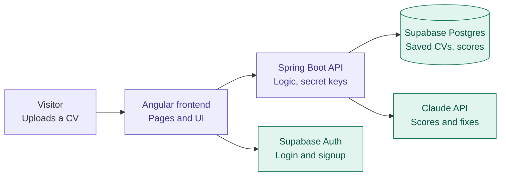

# ApplyCraft: AI Application Assistant

> 🚧 **In active development.** Not production-ready yet.

ApplyCraft helps job seekers find the right job, tailor their CV to it, and get past ATS filters. Upload a CV to get an AI-powered ATS score, see missing keywords and fix issues with one click.

## Features
- ATS score with category breakdown
- Job match: matched and missing keywords
- AI fixes and tailoring to a job description
- ATS-friendly PDF export
- Accounts, saved CVs and score history

**Planned:** job search, cover letter generator, AI interview practice, paid plans.

## Tech stack
- **Frontend:** Angular, TypeScript
- **Backend:** Java, Spring Boot
- **Database & auth:** Supabase (PostgreSQL, EU region)
- **AI:** Claude API (Anthropic)

## Architecture



All secret keys stay in the backend. The frontend only uses the public Supabase key.

## Run locally

```bash
# Backend
cd backend
cp .env.example .env   # fill in your values
./mvnw spring-boot:run

# Frontend
cd frontend
npm install
npm start
```

Open http://localhost:4200

## Author
**Rayan Brigui**, [GitHub](https://github.com/rayan9brx) · [X](https://x.com/Barga_Ray)
